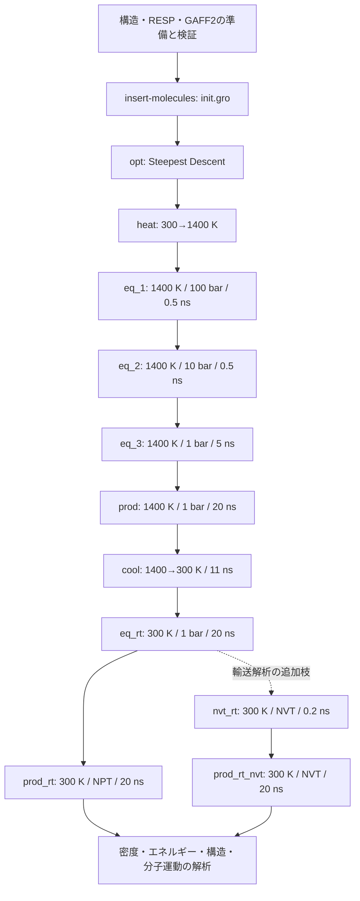

# PMMA / TPS⁺ / CF₃SO₃⁻ レジストモデル MD 習熟チュートリアル仕様書 v2.0

版：2.0 / 作成日：2026-10-27（JST） / 状態：統合仕様策定済み・実装/QM/MD未実施

## 0. v2の設計判断：元の計算との対応を優先する

本仕様の優先順位は、**利用者が再現した元計算との手順・段名・高温条件の対応を維持し、その上で力場作成・検証・冷却・室温解析を充実させる**ことである。v1二案を同時に参照して異なる既定値を混在させず、実装時は本v2を正本とする。

| 判断対象 | v2で採用する仕様 | 採用理由・参照との差 |
|---|---|---|
| 主経路 | `init → opt → eq_1 → eq_2 → eq_3 → prod`を維持 | 元計算のファイルと1対1で対応させる。加熱`heat`はopt後に追加 |
| 高温T/P/時間 | **1400 K、100→10→1 bar、0.5→0.5→5 ns、prod 20 ns** | 元の計算との対応を最優先。500 K案へ自動置換しない |
| 分子数・初期箱 | PMMA100鎖、TPS83個、OTf83個、10 nm角 | 元計算と同じ分子数比・箱 |
| PMMA鎖長 | H終端19量体、約1,904 g/mol | 元の約1,952 g/molに近い整数重合度。20量体も同程度だが基本系を一本化 |
| 力場・電荷 | **GAFF2＋RESP、全形式電荷、非分極** | 力場を一から準備する学習を重視。元の電荷生成法と同一と断定しない |
| PMMAのRESP | H終端3量体/5量体で内部・両端の電荷を制約付きfitし19量体へ転写 | 長鎖全体のQMを最初から要求せず、転写を独立に検証 |
| 力場変換の検証 | 原子対応・全力場項＋**AMBER/GROMACS成分別エネルギー比較** | 正しく変換できた根拠を残す |
| 段間接続 | 最初のみ速度生成、その後cpt継続 | 元の各段速度再生成からの明示的改善。原軌跡との一致は要求しない |
| 最小化 | steep / emtol=100を維持、静電はPMEへ統一 | 元のEMのCut-offからの明示的変更 |
| 冷却 | 1400→300 K、100 K/nsの連続冷却、11 ns | 温度履歴を再現可能な点列で規定 |
| 室温の主経路 | **300 K / 1 bar NPTで再平衡化20 ns→prod_rt 20 ns** | 元prodと同じEDR診断・体積変動・解析の練習ができる |
| 輸送解析の追加枝 | 必要時、同じ室温平衡化状態からNVT再平衡化＋`prod_rt_nvt` | 箱変動と長時間MSDの問題を分けて検証する |
| 実行と学習 | smoke/tutorial/production、Phaseゲート、日本語Notebook | 短い動作検証と本計算を区別し、理解しながら進める |
| 実装運用 | 既存repo/PBS/実環境を利用、manifest・再開・時間接続・予算を明記 | 汎用の別環境へ移行せず、現在の資産を活かす |

1400 Kは**参照に合わせた計算上の混合処理**であり、PMMAやイオンの物性をその温度で正しく表せることを保証しない。短時間検証で構造・数値の健全性を確認し、条件を満たさなければ停止する。温度変更は別variantとして記録する。

v1から引き継ぐ実装の具体性と、別AI案から採用するRESP・電荷転写・成分別エネルギー検証を、以下で一つの実装可能な手順にまとめる。両v1および参照Notebookは変更しない。

## 1. 目的と、この仕様書の使い方

参照 [MD_output_guide.ipynb](MD_output_guide.ipynb) の結果を再現できた利用者が、**分子を自分で定義し、力場・初期配置・MD・冷却・解析を一から構築する**ための実装仕様である。実行先は参照計算を再現した環境を使う。

到達点は、TPSカチオン・PMMA・トリフラートアニオンからなる中性のバルクモデルについて、次を自分で説明し、同じ入力から再実行できることである。

1. 構造と力場を準備し、`.gro` / `.itp` / `.top` / `.mdp` の対応を確認する。
2. `gmx insert-molecules` で初期配置を作り、最小化とNPTによる密度調整を行う。
3. 高温MDの後、冷却・室温NPT再平衡化・室温Production MDを行う。
4. 密度、エネルギー、MSD、拡散係数の評価可否、RDFを検証する。
5. イオン対、クラスター、イオンとポリマーの接触、ポリマー鎖・局所運動を解析する。
6. 数値計算の完走、観測量の安定、統計の十分さ、実材料への妥当性を区別する。

**「必ず実験物性が再現される」という保証はしない。** 習熟を確実に進めるため、各Phaseに入力・成果物・合格基準・失敗時の分岐を設ける。未収束や拡散未観測も、根拠とともに判定できれば学習成果になる。数値結果を得られない段階を、得られたことにして先へ進まない。

本書の数値は、参照Notebookの保存情報、そこからの計算、本教材で採用する設計値に区別する。**本書内のスクリプト名・Notebook名・設定形式は、特記以外は今後実装するもの**であり、現在使えるコマンドと誤認しない。

## 2. 参照から確認できたことと、実行環境の扱い

### 2.1 参照情報

次は参照Notebookのセルと保存出力を読んだ結果であり、元のバイナリ・入力ファイルをこのMacで再検査した結果ではない。利用者の「再現できた」という申告を前提に、再現作業のやり直しは要求しない。

| 項目 | 参照Notebookで確認した値 | 新規系への使い方 |
|---|---|---|
| 元ポリマー | `POL.000` / 304原子 / 約1,952.39 g/mol | PMMAの**1鎖の分子量**を合わせる目安 |
| 元ポリマーの組成表示 | `C106H166O32` | PMMAそのものではない。分子構造を流用しない |
| 元カチオン | TPS / `C18H15S` / 34原子 / +1 e | 同じ化学種を新規作成する |
| 元アニオン | F1 / `C14H20FO6S` / 42原子 / −1 e | CF₃SO₃⁻とは別物。F1の構造・電荷を流用しない |
| 分子数 | ポリマー100鎖、TPS83個、F1 83個 | 基本案は鎖数とイオン対数を維持 |
| 初期箱 | 10 × 10 × 10 nm³ | 基本案として維持。挿入可否は新規系で確認 |
| 最小化 | `steep`、最大50,000 step、`emtol=100` | 終了理由とFmaxを読む練習に使う |
| NPT | 1400 K、100→10→1 bar、0.5→0.5→5 ns | 段階構成を継承する |
| 高温本計算 | 1400 K、1 bar、20 ns、1 fs/step | 高温での混合・解析練習として継承する |
| 制御 | V-rescale / C-rescale、τT=1 ps、τP=5 ps | 基本設定として継承する |
| 元の段間接続 | 各段で`gen_vel=yes`、`continuation=no` | 新規系は最初だけ速度を生成し、その後は継続する（明示的変更） |
| 先輩の計算 | GROMACS 2022.5、16 MPI rankというログ | 過去の実行条件として保存 |
| 利用者の再現計算 | GROMACS 2026.3という記載・保存出力 | **新規系の実行環境の第一候補** |
| 実行方式 | PBS、16 CPU要求、利用者側は30時間walltime追記との記載 | 現在の再現成功ジョブを実機で読み直して確定 |

元系のitpでGAFFに似た型名が見えても、それだけではGAFF/GAFF2の版や電荷生成法は特定できない。原入力・生成ログを取得できれば調査し、取得できなければ「元力場の由来未確認」と残す。v2のGAFF2＋RESPは新規系の明示的な選択である。

参照の高温密度約0.447 g/cm³やRDFピークは、組成と力場が異なる新規系の合格値には使わない。Notebook内の「平均密度差0.01 g/cm³なら同じ」という目安も、そのまま一般化しない。

### 2.2 「同じ環境」の定義

この作業ディレクトリはMac上にあるが、参照Notebookの保存出力にはLinux/HPC上の実行パスとPBSジョブが記録されている。Mac側の既存GROMACS 2025.4環境を、再現成功環境と同一視しない。

Phase 0で、利用者が再現に使った環境から次を採取し、`environment_report.json` と `environment_report.txt` に保存する。

- OS、CPUアーキテクチャ、メモリ、空き容量、作業用領域、保存先。
- GROMACS実行ファイルの実体と `gmx --version`、MPI/thread-MPI、精度、SIMD、GPU対応。
- Python interpreter、Jupyter kernelspecの`argv[0]`、パッケージ一覧。
- AmberToolsの`antechamber` / `sqm` / `resp` / `parmchk2` / `tleap` / エネルギー評価用engine、ACPYPE、ParmEdの実体とバージョン。
- PySCFとgeomeTRICの実体・版、CPU thread/メモリ上限、RESP入出力の互換性。
- RDKit、NumPy、pandas、Matplotlib、MDAnalysis、pyedr、nbformat、PyYAMLの利用可否。
- 成功したPBSスクリプト、queue、resource要求、launcher、環境変数、PATH、実際のrank/thread数。
- 実行バイナリとモジュール一覧。バージョン文字列だけで一致としない。

Notebookのカーネル表示名は `Python (GROMACS MD Workbench)` / IDは `gmx-md`。ただし、同名でもマシンごとに実体が異なるため、**実行先で `sys.executable` とtool実体を照合**する。既存の環境検査コードは再利用できるが、既存`probe_server.sh`はSlurm中心なのでPBSの`qstat`や成功済みジョブの確認を追加する。

既存の[Mac環境記録](../docs/current_pc_setup.md)と[QM依存定義](../env/requirements-qm.txt)にはPySCF/geomeTRICによるエタノール教材の実績がある。これは部品再利用の候補であり、HPCでの導入済み・S/F対応・今回の電荷転写まで検証済みという意味ではない。エタノール専用コードはそのまま実行せず、分子・総電荷・元素・RESP制約を一般化した専用処理を実装する。

まず既存環境で実行可能かを検査する。不足ツールがあれば、追加内容・保存先・容量・既存環境への影響を提示してから導入する。今回の仕様書作成だけでは、インストール、環境更新、HPCへの接続・ジョブ投入を行わない。

## 3. モデルの定義

### 3.1 基本組成

本書ではTPSを**トリフェニルスルホニウム（triphenylsulfonium）カチオン**と解釈する。略称だけでなく、構造式・形式電荷・分子式で固定する。

| 化学種 | トポロジー分子名 | 残基名の案 | 電荷 | 基本個数 | 構造の定義 |
|---|---|---|---:|---:|---|
| PMMA19 | `PMMA19` | `PMM` | 0 | 100鎖 | MMAをhead-to-tail結合した19量体、両末端H終端 |
| TPS⁺ | `TPS` | `TPS` | +1 | 83個 | Sにフェニル基3つが結合したカチオン |
| CF₃SO₃⁻ | `OTF` | `OTF` | −1 | 83個 | トリフラート。トリフルオロメタンスルホン酸イオン |

構造生成の入力例：TPSは `c1ccc([S+](c2ccccc2)c2ccccc2)cc1`、OTfは `O=S(=O)([O-])C(F)(F)F`。SMILES文字列は分子グラフ検査を通してから採用する。CF₃SO₃Hや、中性のS原子を持つ別のTPSを作らない。

初期箱は立方体10 nm角、PBCはxyz、溶媒・水・基板・真空層は入れない。1鎖の分子量と箱全体の総分子量は区別する。

### 3.2 PMMAの重合度・末端・立体規則性

繰り返し単位は `–CH₂–C(CH₃)(C(=O)OCH₃)–`、組成はC₅H₈O₂、約100.117 g/mol。モノマーのC=Cを残したまま単に19個並べた構造にしない。

採用案は**重合度19、直鎖、head-to-tail、両端の未結合価をHで終端**する。したがって組成はC₉₅H₁₅₄O₃₈、全水素を含め287原子、分子量は約1,904.24 g/molとなる。参照1,952.39 g/molとの差は約−2.47%。20量体は約2,004.36 g/mol、差約+2.66%なので、H終端の条件では19量体を選ぶ。

これは分子量を合わせた**単分散オリゴマー教材**であり、長鎖の実用PMMAの分子量分布・絡み合い・Tgをそのまま表さない。

立体配置は、seed 42で生成するランダムな固定立体配列を基本とする。実際に立体中心となる原子を分子グラフから判定し、atom-map番号、絶対配置、meso/racemo dyadを保存する。「R/Sをランダムに指定した」という記録だけでアタクチック性を保証しない。鎖末端などで立体中心でない原子も区別する。

最初の教材では、この**1つの固定立体配列のトポロジーを100鎖に使用**する。これはアタクチック鎖の一実現を複製した近似である。立体配列を複数に増やす検討は発展課題とし、基本系の途中で勝手に変更しない。各鎖の向き・位置は挿入時にランダム化する。初期配座が共通である影響は、高温でのRg・二面角・接触の時間変化で確認する。

### 3.3 分子数比と質量分率

参照と同じ個数比を採用すると、次の設計値になる。値は一般的な原子量からの概算で、最終値は**採用したトポロジーの質量**から再計算する。

| 量 | 基本案の値 |
|---|---:|
| TPS⁺の分子量 | 約263.38 g/mol |
| OTf⁻の分子量 | 約149.06 g/mol |
| 1塩対の式量 | 約412.44 g/mol |
| 総原子数 | **32,186** |
| 分子数 | 266（100鎖＋83＋83） |
| 総電荷 | 0 e |
| イオン対数 / PMMA鎖数 | 0.83 |
| イオン対数 / MMA単位数 | 約0.04368 |
| 塩の質量 / 全質量 | **約15.24 wt%** |
| 塩の質量 / ポリマー質量 | 約17.98 wt% |
| 初期密度（10 nm角） | 約0.3731 g/cm³ |

塩の比率を実材料に合わせる依頼がないため、今回は個数比を維持する。「参照と同じ個数比」と「参照と同じ塩の重量比」は両立しないことを説明する。別の配合を試すときは別config・別runとして扱う。

### 3.4 物理モデルの適用範囲

本教材の標準は、GAFF2＋RESPの固定電荷・固定結合の非反応性全原子MDとする。

- 観測するのは、未露光バルク中のPAGイオンの配置、会合、移動、ポリマーとの局所接触と鎖運動である。
- TPSの光分解、酸の発生、プロトン移動、酸触媒脱保護、架橋、溶解、パターン形成は計算しない。
- **OTf⁻の移動を「光酸の拡散係数」と呼ばない。** 酸を生成する反応もプロトンもモデルにない。
- PMMA単独は、参照の酸脱保護型ArF樹脂と同一材料ではない。これは指定3成分によるレジスト関連モデルである。
- 1400 Kは参照に合わせた計算上の高温処理である。実材料の熱履歴ではなく、力場の通常の較正範囲からも外れ得る。結合が切れないことは、高温の物性や配置が正しいことを意味しない。
- 分解・分極・電荷移動を無視する誤差、末端・有限サイズ・冷却速度・力場による誤差を最終報告に残す。

1400 Kで数値不安定や極端な分子内変形が起きたら、時間刻みと力場を検査する。無断で温度を下げて「同条件」とはしない。600–800 K程度から開始する代替プロトコルは、高温のモデル外挿を減らせる一方、緩和が遅くなり参照から条件が変わるため、別の設計判断として提示する。

## 4. 実装成果物と保存構成

既存エタノール教材と参照Notebookは保存し、新規系専用の構成を追加する。共有ライブラリを変更する場合も既存RESP入力の必須条件を緩めない。

```text
examples/pmma_tps_otf/
  README.md                         # 実行先・カーネル・最短の開始手順
  PROGRESS.md                       # Phase状態、証拠、次の1手
  decisions.md                      # 採用条件・変更理由・未解決事項
  config/system.yaml                # 物理モデルと組成の正本
  config/protocol.yaml              # ステージ・時間・保存間隔の正本
  notebooks/
    00_environment_and_plan.ipynb
    01_molecular_structures.ipynb
    02_force_field.ipynb
    03_initial_packing.ipynb
    04_minimization_and_preflight.ipynb
    05_high_temperature_md.ipynb
    06_cooling_and_room_temperature.ipynb
    07_standard_analysis.ipynb
    08_resist_molecular_behaviors.ipynb
    09_validation_and_report.ipynb
  scripts/                          # Notebookからも呼ぶ処理の実装
  templates/pbs/                    # 実機確認後のPBSスクリプト
  templates/report.md
systems/pmma_tps_otf/
  structures/                       # canonical SDF、atom_map、site_map、立体配置
  parameters/                       # QM/ESP/RESP、転写、Amber/GROMACS、検査記録
  topology/                         # 共通defaults/atomtypes、topol.top
  mdp/                              # configから生成した全段の入力
runs/pmma_tps_otf/<run_id>/
  manifest.json                     # 入出力実パス・hash・実行条件・親run
  environment/                      # 実機検査・package一覧
  00_pack/ 01_opt/ 02_heat/ 03_eq_1/ ...
  analysis/                         # CSV、XVG、図、解析条件
  executed_notebooks/               # 実行済みNotebook。元教材と分離
  reports/                          # 合格判定、性能、最終報告
```

`runs/`は既存のignore方針を踏襲する。HPCでの大容量出力は、その環境のwork/scratchへ保存し、configとmanifestで対応付ける。scratchの保持期限を調べ、削除前に最終構造・checkpoint・入力・解析結果・必要な軌跡を保存先へ退避する。

各stageは独立ディレクトリで実行する。`mdout.mdp`の上書きを避け、`<stage>_effective.mdp`、`<stage>_processed.top`、gromppのstdout/stderrを残す。原本の構造・力場は採用後にhashで固定する。

### 4.1 設定の正本と最小例

実装時に`system.yaml`へ最低限次を保持する。これは**新規に実装する設定形式の案**であり、既存CLIへそのまま渡せる設定ではない。計算の前にschema検査を行い、未設定の実行先・tool・力場レビューを暗黙の既定値で補わない。

```yaml
schema_version: 2
system_id: pmma19_tps_otf
model:
  polymer:
    degree: 19
    linkage: head_to_tail
    end_caps: [H, H]
    stereochemistry: seeded_fixed_sequence
    stereo_seed: 42
    conformer_seed: 43
    count: 100
  cation: {identity: triphenylsulfonium, charge_e: 1, count: 83}
  anion: {identity: triflate, charge_e: -1, count: 83}
  initial_box_nm: [10.0, 10.0, 10.0]
  pbc: xyz
force_field:
  family: gaff2
  charge_model: resp
  charge_scale: 1.0
  polymer_charge_route: constrained_oligomer_transfer
  qm_backend: pyscf
  qm_method: RHF
  qm_basis: 6-31g*
  review_status: pending
execution:
  target: reproduction_success_environment
  scheduler: pbs
  mode: production
  run_root: null
  gmx_bin: null
  python_bin: null
  queue: null
  launcher: null
```

`protocol.yaml`にはstageごとのT/P/ensemble、`duration_ps`、dt、出力間隔、冷却の相対点列、延長履歴を持たせる。MDP・step数・累積時刻はそこから生成する。NVTの追加枝には`pressure_bar: null`とし、1 barを制御したと記録しない。実行先等の未解決`null`と、NVTでは適用しないという意味の`null`はschemaで区別する。

さらに`charge_protocol.yaml`を設け、分子・電荷・多重度、配座、QM、ESP格子、RESPの拘束/等価性、転写行列、適用先、検証条件を保持する。主要な未解決事項があれば`pending`とし、MD本番投入を禁止する。

### 4.2 実行モード

| モード | 分子系と計算 | 結果の扱い |
|---|---|---|
| `smoke` | 例：PMMA2鎖＋TPS1＋OTf1、最初は10 nm箱、短いEM/MD/接続・再開テスト | 小さい低密度系での動作試験。バルク物性に使わない |
| `tutorial` | 基本100/83/83の箱で各stageを短縮して全処理を確認 | 手順検証。元の20 nsに相当する結果と呼ばない |
| `production` | 本書の基本時間と平衡化判定、独立replica | 本計算・解析対象。必要時は延長 |

モードを変えても分子定義・採用済み力場・電荷モデルは変えない。短縮したMDを架空の物性データで埋めない。`tutorial`の時間は基本時間の例1/100とし、冷却のT端点は維持して時間軸を同じ倍率で縮める。出力間隔も実行時間に対し十分なframeが得られるよう生成し、短縮時間・実効冷却速度を出力へ明記する。

## 5. Phase 0：環境確認と計画の固定

**入力：** 本仕様、参照Notebook、再現成功環境とそのジョブファイル。

**実装内容：** 環境検査、参照条件の抽出、基本config、ディレクトリ、進捗台帳を作る。Notebookの保存出力にある絶対パスを新規コードへ直書きせず、`repo_root` / `run_root` / `reference_root` / `gmx_bin`で管理する。

**成果物：** `00_environment_and_plan.ipynb`、環境レポート、config、`PROGRESS.md`、`decisions.md`。

**合格基準：** 実行先のPython・GROMACS・PBSの対応が確認でき、依存不足と入出力先が明記されている。構造・力場・長時間計算の未実施状態が区別されている。

HPCにCodexから接続できない場合は、実行コマンドとPBSスクリプトを用意し、利用者が実行したログを検査して進める。ローカルの成功をHPCでの成功として記録しない。

## 6. Phase 1：分子構造を一から作る

### 6.1 生成手順

1. RDKitでTPSとOTfの結合・形式電荷を指定し、明示的H付きSDFを保存する。
2. PMMAの繰り返し単位を、結合点を明示した分子グラフ操作で19個結合する。末端H、主鎖の飽和、エステルのC=O、総形式電荷0を検査する。
3. PMMAの立体配置を固定し、seed 43で初期3D配座を生成する。配座生成・分子内最適化のmethod、収束、失敗も保存する。
4. canonical SDFを正本とし、mol2/gro等へ変換する。全形式間のatom-mapを作る。
5. 3D表示と、分子式・質量・電荷・結合数・結合次数・立体配置の表を作る。

RDKitのMMFF等による構造調整は、初期配座作成の補助である。TPSなどでパラメータ非対応なら、既定法の成功を装わず、後述のGAFF2最小化等へ明示的に切り替える。最終MD力場と同じものを使ったと誤記しない。

### 6.2 原子と解析サイトの対応

`atom_map.csv`に化学種、canonical atom ID、元素、形式電荷、結合相手、mol2 ID、GROMACS原子番号・原子名を保存する。元素を原子名の先頭1文字だけから推定しない。

`site_map.json`には少なくとも以下を定義する。

- TPSの中心S、芳香環C/H。
- OTfのS、3つのスルホン酸O、CF₃のC/F。
- PMMAの主鎖C、カルボニルO、エステル単結合O、側鎖メチル、末端、繰り返し単位ID。
- 分子IDと鎖ID。**残基と分子は別概念**として扱う。

`.gro`の番号は桁制限で巡回する場合がある。分子数を`residの一意数`だけで判定せず、トポロジーの分子境界とatom-mapで検査する。

**成果物：** `01_molecular_structures.ipynb`、3種のcanonical SDF、立体配置記録、map、構造図。

**合格基準：** PMMA19=287原子、TPS=34原子、OTf=8原子、形式電荷0/+1/−1、意図した結合グラフ、立体配置、変換前後の原子対応が一致する。PMMA中に未反応モノマーのC=Cがない。

**失敗時：** 分子量を合わせるために原子を足し引きしない。結合点・末端・Hの付加を修正して再生成する。

## 7. Phase 2：RESP電荷・力場・GROMACS入力を作る

### 7.1 採用経路と段階分け

標準は**GAFF2＋RESP、分子電荷0/+1/−1、電荷scale=1.0**とする。電荷は全原子に分布し、S原子だけを±1にしない。AM1-BCCは別IDのsmoke用比較variantとして利用できるが、RESP未完了の本番系を自動的に置換しない。

Phase 2は、2a：QM/RESP手順と原子対応、2b：電荷転写とfit評価、2c：力場変換とエネルギー比較、の3つの小ゲートに分ける。長時間QMの前に1配座・1分子から処理を検証する。

既存の`src/mdworkbench/parameterization/pyscf_ethanol.py`は、中性エタノール・H/C/O・特定のRESP固定原子を前提にしている。TPS/OTfをその関数へ渡したり、エタノールの「O電荷固定」ルールをコピーしたりしない。`resp.py`や`amber.py`の明示的電荷入力・hash記録・変換機能を必要に応じて再利用し、既存教材の科学的条件は変更しない。

### 7.2 QM/ESPの標準入力

既存環境を活かす第一候補は**PySCF＋geomeTRIC＋AmberTools resp**である。Gaussian等の有料ソフトを必須にせず、実行先で利用可能なbackendをPhase 0で確認する。下表は今回の**教材用プロトコルの設計値**であり、元レジスト計算の電荷生成条件だとは主張しない。

| 項目 | 初期仕様 |
|---|---|
| QMモデル | TPS(+1)、OTf(−1)、H終端PMMA3/PMMA5(0)。全て閉殻一重項、PySCF spin=0 |
| 方法 | 気相RHF/6-31G*で構造最適化、同レベルの最終SCF/ESP |
| SCF | `conv_tol=1e-10 Eh`、最大100 cycle。未収束なら停止して再検討 |
| 構造最適化 | geomeTRIC、最大100 stepを出発点。終了条件と実勾配を記録 |
| 配座 | TPS、PMMA3、PMMA5はseed固定で原則3つの異なる配座、OTfはまず1配座。重複はRMSD等で判定 |
| 資源 | thread数・メモリ上限・scratch・walltimeを実行環境に合わせて明示し、1配座で実測 |
| ESP | 4つの露出vdW shell（半径倍率1.4/1.6/1.8/2.0）、Fibonacci点、名目密度1点/Ų |
| 半径 | H 1.20、C 1.70、O 1.52、F 1.47、S 1.80 Åを本教材の入力値として固定 |
| 単位 | 格子/核座標の原本はÅ、RESPへの出力はbohr、ESPはatomic units |
| 配座重み | 原則等重み。点数の多い配座やPMMA5だけが支配しないよう正規化を記録 |

既存エタノールの格子は独自の露出Fibonacci shellであり、GaussianのMK格子と同一ではない。本教材でも同じ名称で区別する。点密度を倍にしたときのfit変化、原子内側の点の混入、遠方ESPの総電荷との整合、電子/核寄与の符号・単位を検査する。625点などエタノールの点数を固定値として移植しない。

イオンの6-31G*は、AMBER型電荷生成との対応を重視した出発点である。特にアニオンの拡散関数・分極・配座依存性を無視できるとは断定しない。必要な感度比較は別variantとして計画し、基底やQM法を一部の分子だけ無断変更しない。最適化後は結合グラフ・立体配置が保存され、TPSのC–S等が意図した化学種のままであることを確認する。

TPSの複数初期配座が同じ極小へ収束した場合は、その事実を記録して重複を除く。異なる最適化構造が3つ得られたと装わない。PMMAのfit用/評価用の配座分離とは別に、イオンの採用配座数と不足の影響をレビューする。

### 7.3 TPS/OTfのRESP

- 分子総電荷をTPS=+1、OTf=−1に拘束する。原子順はcanonical atom-mapから対応させる。
- TPSの化学的等価サイト、OTfの等価なO/Fを分子グラフと立体化学から定義し、制約を保存する。空間的に近いだけの原子を等価にしない。
- RESPの初段は`qwt=0.0005`、`ihfree=1`を設計値とする。配座間で同一atom-mapの電荷を共有し、等価性と電荷和を同時に満たす。
- 後段でメチルC/Hの等価化・再fitを行う場合は`qwt=0.001`を出発点とし、固定/自由原子を列挙する。TPS/OTfにはCH₃群がないので、機械的にエタノールの第2段を実行しない。必要な等価性を初段に含め、使用段数とその理由を記録する。
- 収束判定、配座ごとのQM ESP対fit ESP、RMSE、最大残差、電荷表を保存する。ファイルが出たことだけでfit合格にしない。

GAFFと電荷モデルの背景は[Amber公式GAFF解説](https://ambermd.org/antechamber/gaff.html)、実際のRESP制約形式は採用AmberTools版のマニュアルとCLIで確認する。RESPを使うこと自体は凝縮相・イオン対の精度保証ではない。

### 7.4 PMMAの電荷転写を具体化する

PMMA19全体の高コストQMを初回の必須条件にせず、**H終端3量体と5量体を用いた制約付きRESP**を基本にする。単量体の電荷を19回貼り付ける方法は使わない。

1. PMMA19と同じhead-to-tail結合・H終端でPMMA3/5を作る。式と原子数はPMMA3=C15H26O6/47原子、PMMA5=C25H42O10/77原子。各原子を`head`、`internal`、`tail`の単位と化学役割へ対応付ける。
2. 外付けの開始剤や追加メチルcapは使わず、最終鎖と同じH終端を使う。headとtailの役割は方向を固定し、入れ替えない。
3. PMMA3/5の配座・立体配列を記録する。内部単位の電荷は同じ役割のtemplateを共有する。これは内部の電荷を立体配列・局所配座間で平均化する近似であり、全ての環境を厳密に区別したモデルではない。
4. fitの変数はhead、internal、tailそれぞれのatom-roleの電荷とする。各オリゴマーへの展開行列を作り、同じ役割の電荷を共有してQM ESPへ同時にfitする。
5. **head、internal、tailを各0 eにする局所中性の制約**を初期モデルとして採用する。これにより`Q(PMMA19)=Qhead+17×Qinternal+Qtail=0`となる。局所中性は転写のための近似なので、ESP再現への影響を独立に検証する。
6. CH₃水素の等価性は化学グラフで定義する。CH₂のジアステレオトピックなHなどを無条件に同一電荷にしない。第2段を使う場合は非メチル原子を第1段値に固定し、CH₃のC/Hのみを制約付き再fitする。固定集合と線形拘束の整合を事前検査する。
7. まず各オリゴマーの配座1/2をfit用、配座3を評価用に分ける。fitに使わなかった配座のESP、3量体と5量体それぞれの残差・電荷依存性を確認する。配座を3つ用意できなければ不足を記録し、独立評価がない状態を合格扱いしない。
8. 同じ格子・配座での分子ごとの非転写RESPと比較し、局所中性・template化によるESP誤差増加を評価する。目安としてRMSEの25%以上の悪化を要再検討フラグとする。元のRMSEが非常に小さい場合は絶対誤差も見て判断する。小さな相対差だけで元のfit精度が十分だと断定しない。
9. 採用templateをPMMA19へ展開し、**全287原子を過不足なく1回ずつ**割り当てる。末端をinternalで代用しない。元fitを離れた一律オフセットや、特定原子への残差押し込みは禁止する。

`charge_mapping.csv`、template電荷、fit/評価用配座、拘束行列とrank、ESP評価表を保存する。転写でESP再現が不十分なら、QMモデル拡大、templateの分割、全鎖RESP、検証済み文献モデル等を比較して設計を再検討する。変更理由・費用を具体化し、AM1-BCCへの自動切替で隠さない。

### 7.5 GAFF2・Amber topology・GROMACS入力

```text
canonical SDF / QMモデル
  → PySCF最適化・ESP → RESP → 検証済み電荷（0/+1/−1）
  → antechamber（GAFF2型、既存電荷を読み込む。電荷を再計算しない）
  → parmchk2（GAFF2）→ frcmod
  → tleap（leaprc.gaff2、check、prmtop/inpcrd）
  → ACPYPE（Amber topologyを変換）
  → 単分子gro/itp → 共通力場 + topol.top
```

PMMAの主鎖・末端を含む結合/角/二面角は、**完成したPMMA19の結合グラフ**に対して型付け・生成する。電荷templateを転写したことは、単位境界の結合・二面角パラメータが生成されたことを意味しない。

必須レビューは、全原子の電荷・質量・型・対応、TPSのC–S・C–S–C、OTfのS–O/S–C/C–F、PMMAの主鎖二面角・エステル・末端・improper、exclusion、1–4 pairである。`ATTN`、欠損、ゼロ力定数、類推パラメータを抽出する。未審査の類推値を「標準値」として採用しない。主要なSや主鎖パラメータが解決しなければ停止する。

構成は`forcefield.itp`（defaultsを1回）、`atomtypes.itp`（全分子より前）、`PMMA19.itp`、`TPS.itp`、`OTF.itp`、`topol.top`とする。同名型でLJ値が異なる場合は停止する。GAFF2変換に対応する`nbfunc=1`、`comb-rule=2`、`gen-pairs=yes`、`fudgeLJ=0.5`、`fudgeQQ≈0.833333`を実際のAmber topologyと照合する。

```text
#include "forcefield.itp"
#include "atomtypes.itp"
#include "PMMA19.itp"
#include "TPS.itp"
#include "OTF.itp"

[ system ]
PMMA19 TPS triflate bulk model v2

[ molecules ]
PMMA19  100
TPS      83
OTF      83
```

電荷は原則8桁以上で保持し、分子電荷誤差≤1e-5 e、系全体≤1e-3 eを目安とする。出力丸めが原因なら高精度原本から再出力する。

### 7.6 成分別エネルギー比較と力場ゲート

**変換検証を必須にする。** ただしAMBERとGROMACSの出力項目名が同じとは限らないため、比較可能な項への対応表を作る。これは変換の検証であり、力場の実験精度を証明する検査ではない。

- 同一座標・同一原子順で、各単分子、PMMAの複数配座、TPS–OTfの複数距離/向きを評価する。
- まず非周期・拘束なしの同条件で、bond、angle、proper/improperの合計、LJ-14、Coulomb-14、非結合LJ/Coulombを分けて比較する。cutoff・除外・1–4・シフト・単位を一致させ、拘束による定数項の有無も揃える。
- 長距離項や出力分解が違う場合は、同じ物理量になる組合せへ変換し、比較できない項を無理に同名比較しない。周期箱/PME/分散補正の追加検査はこの後に行う。
- 最初の許容差案は各比較項について`abs(ΔE) ≤ max(0.01 kJ/mol, 1e-4×abs(Eref))`。大系や精度の違いで調整する場合は数値収束の根拠を先に記録し、差が出た後に無根拠に緩めない。
- 合計エネルギーが合っても項ごとの誤差が相殺していれば不合格。差があればatom order、単位、係数、LJ混合、1–4、二面角の多重項から原因を追う。
- 評価engineは実環境のAmberTools `sander`等を第一候補とする。利用できなければengine/独立評価法を準備し、未実施のまま変換検証合格としない。

**成果物：** `02_force_field.ipynb`、QM/ESP/RESP、電荷転写一式、mol2/frcmod/prmtop/inpcrd、採用gro/itp/top、エネルギー比較CSV、`force_field_review.md`。

**合格基準：** 2a/2b/2cを実行済み、原子対応・電荷・fitと転写・全力場項・成分別エネルギーを検査し、未解決の致命的問題なし。`grompp`の警告未解決や、未実行のQM/変換検査を次段の本番入力に使わない。採用データと利用条件、hashを固定する。

## 8. Phase 3：初期配置を作る

参照と同じ`gmx insert-molecules`を使う。[公式説明](https://manual.gromacs.org/documentation/2026.3/onlinehelp/gmx-insert-molecules.html)のとおり、これは同じ入力分子を回転・並進して挿入する処理で、鎖の内部配座を探索する処理ではない。

以下は、採用した単分子groを作業ディレクトリへコピーした後の例である。実装では引数リストでコマンドを組み、終了コードを検査する。

```bash
gmx insert-molecules -box 10 10 10 -ci PMMA19.gro -nmol 100 -try 10000 -seed 1 -o init0.gro
gmx insert-molecules -f init0.gro -ci TPS.gro -nmol 83 -try 10000 -seed 1 -o init1.gro
gmx insert-molecules -f init1.gro -ci OTF.gro -nmol 83 -try 10000 -seed 1 -o init.gro
```

初回replicaは参照の挿入seed=1を3回とも使用する。新しい分子なので座標一致は期待しない。各挿入のログ・実挿入数・原子数・分子順序・箱・密度・最短分子間距離を検査する。`-nmol`の要求数が全部入ったことを、出力ファイルの存在だけで判定しない。

挿入半径は力場のLJパラメータと同じ意味ではない。`vdwradii.dat`、atom名からの半径割当、`-radius` / `-scale` / `-rot`の**使用値**を保存する。入らないときは、まず配座・箱サイズ・試行回数を検討し、半径だけを極端に下げて押し込まない。箱を変えた場合は初期密度とconfigを更新する。別packerの採用は変更理由を記録する。

**成果物：** `03_initial_packing.ipynb`、`init0.gro` / `init1.gro` / `init.gro`、3段のログ、検査表、初期配置の3D表示。

**合格基準：** 100/83/83分子、32,186原子、分子順序PMMA→TPS→OTF、総電荷0、意図した箱、明らかな分子内破綻なし。距離検査に加えて次Phaseの0-step力評価を通す。乱数seedの固定だけで異なるGROMACS版間の座標一致は保証しない。

## 9. 全MD段階の計算設計

### 9.1 基本プロトコル

`prod`は参照と対応する**高温NPTのProduction**、`prod_rt`は追加する**300 K / 1 bar NPTのProduction**とする。どちらも必須であり、高温本計算を任意扱いにしない。元計算と同じ種類の密度・体積・エネルギー診断を両温度で行う。

| 段階 | アンサンブル・条件 | 基本時間 | step数（1 fs） | 主な目的 |
|---|---|---:|---:|---|
| `opt` | Steepest Descent、PME | 時間なし | 最大50,000 | 重なりと過大な力を解消 |
| `heat` | NVT、300→1400 K | 0.2 ns | 200,000 | 初回速度生成、段階的加熱 |
| `eq_1` | NPT、1400 K / 100 bar | 0.5 ns | 500,000 | 初期の低密度箱を圧縮 |
| `eq_2` | NPT、1400 K / 10 bar | 0.5 ns | 500,000 | 目標圧力を段階的に下げる |
| `eq_3` | NPT、1400 K / 1 bar | 最初5 ns | 5,000,000 | 高温で体積・構造の安定を検査 |
| `prod` | NPT、1400 K / 1 bar | 最初20 ns | 20,000,000 | 元prodに対応する高温本計算 |
| `cool` | NPT、1400→300 K / 1 bar | 11 ns | 11,000,000 | 100 K/nsで連続冷却 |
| `eq_rt` | NPT、300 K / 1 bar | 最初20 ns | 20,000,000 | 室温の密度・構造の安定を検査 |
| `prod_rt` | NPT、300 K / 1 bar | 最初20 ns | 20,000,000 | 室温の物性診断・構造・運動 |

基本主経路は**77.2 ns＋最小化**。時間はproductionモードの検証開始値であり、平衡化・サンプリング不足なら予算を示して延長する。0.2 nsの加熱が不安定なら加熱時間を延ばす。100 barは参照に合わせた準備操作である。



室温の輸送解析を深める場合は、採用済み`eq_rt`の状態を親として、次の枝を追加する。

| 追加段階 | 条件 | 初期時間 | 位置づけ |
|---|---|---:|---|
| `nvt_rt` | 最終箱を固定、300 K | 0.2 ns | アンサンブル切替後の再確認 |
| `prod_rt_nvt` | 同じ箱、300 K、NVT | 20 ns | 分子COMのMSD・定量D評価の標準枝 |

この枝は`prod_rt`の代替や独立replicaではなく、**同じ親状態からの別アンサンブル計算**である。追加計算量は20.2 ns、主経路と合わせて97.4 ns/replica。NPTの診断で拡散未観測なら、NVTを追加すればDが必ず得られるとは考えず、目的と予算で実施を判断する。

NVT枝の開始箱は`eq_rt`の最終箱とする。最終体積が採用区間の平均から1%以上外れる場合は、代表性を再検討してNPT延長等を判断する。NVTでは体積が一定なので、その密度の横ばいを再平衡化の証拠に使わない。NVTの平均圧力が1 barから有意に外れる場合も事前NPTと体積を点検する。

参照との差は、分子の変更、新規GAFF2/RESP、EMのPME化、追加加熱、段間継続、追加冷却・室温計算である。NVT枝は輸送解析の補助であり、主経路のNPTとの対応を崩さない。

### 9.2 共通MD設定の設計値

次は本教材の初期設定である。MDP生成時には単位、適用するstage、実機で解決された値を確認し、重複キーを禁止する。

| 分類 | 基本値 |
|---|---|
| 積分 | `integrator=md`、`dt=0.001 ps`、`pbc=xyz` |
| 非結合 | `cutoff-scheme=Verlet`、`nstlist=20`、`verlet-buffer-tolerance=0.005` |
| 静電 | `coulombtype=PME`、`rcoulomb=1.0 nm`、`ewald-rtol=1e-5` |
| PME格子 | `pme-order=4`、`fourierspacing=0.12 nm`。実際の格子寸法も保存 |
| LJ | `vdwtype=Cut-off`、`rvdw=1.0 nm`、`vdw-modifier=Potential-shift`、`DispCorr=EnerPres` |
| 拘束 | `constraints=h-bonds`、`constraint-algorithm=lincs`、`lincs-order=4`、`lincs-iter=1` |
| 温度 | `tcoupl=v-rescale`、`tc-grps=System`、`tau-t=1.0 ps` |
| NPT | `pcoupl=c-rescale`、`pcoupltype=isotropic`、`tau-p=5.0 ps`、`compressibility=4.5e-5 bar^-1` |
| NVT | `pcoupl=no`。圧力制御パラメータをNPTから誤継承しない |
| COM | `comm-mode=Linear`、`comm-grps=System`、`nstcomm=100` |
| エネルギー | `nstcalcenergy=100`、`nstenergy=1000`、`nstlog=1000`（記録は1 psごと） |
| 座標 | `nstxout=0`、`nstvout=0`、`nstfout=0`、`nstxout-compressed=1000`、全原子 |
| XTC精度 | `compressed-x-precision=10000`（0.0001 nm）。短距離・低移動量の分解能も検査 |
| 初速度 | `heat`だけ`gen-vel=yes`、`gen-temp=300 K`、初回replicaの`gen-seed=1` |
| 段間継続 | それ以降`gen-vel=no`、`continuation=yes`、前段cptを使用 |
| stochastic seed | 基本replicaは`ld-seed=201`。実際に採用されたseedを保存 |
| 冷却以外 | `annealing=no`を明示。`heat`のみ加熱、`cool`のみ冷却 |

`heat`はMD最初の段なので`continuation=no`とし、最小化後にh-bondsを適用する。`annealing=single`、2点の時刻0/200 ps、温度300/1400 Kで加熱する。この段だけ速度を生成し、後段では前段の速度を継承する。

PMMAの圧縮率として水のような値が正しいと主張しない。ここではバロスタットの初期制御値であり、平均物性のfitには使わない。体積振動・不安定があればτPと併せて検査する。種別ごとのCOM除去や、小さいイオングループごとの過剰な温度制御は行わない。

温度・圧力の目標値は各stageから取得する。最小箱長は、全NPT軌跡について少なくとも最大非結合カットオフの2倍を超えることを検査し、さらに実効neighbor-list半径の制約も満たす。`rlist`等の実効値はgrompp出力から記録する。

上表は出発点であり、高温の時間刻み・拘束・cutoffの妥当性は短いpreflightと必要な比較計算で検査する。MDPキーの意味は[GROMACS 2026.3公式パラメータ説明](https://manual.gromacs.org/documentation/2026.3/user-guide/mdp-options.html)を参照する。

### 9.3 時間・checkpointの接続を曖昧にしない

MD開始を0 psとする累積時間をmanifestで管理する。`tinit=0`、`init-step=前段の最終global step`、`nsteps=今回追加するstep数`を生成し、前段checkpointのstep・timeと照合する。EMのstepはMDの累積時間に加えない。dtを変えた場合はこの単純なstep換算を使わず、接続時刻を再設計する。

延長がない基本主経路の累積時刻は、`heat:0–200`、`eq_1:200–700`、`eq_2:700–1200`、`eq_3:1200–6200`、`prod:6200–26200`、`cool:26200–37200`、`eq_rt:37200–57200`、`prod_rt:57200–77200 ps`である。

NVT枝は`eq_rt`の57200 psから分岐し、`nvt_rt:57200–57400`、`prod_rt_nvt:57400–77400 ps`となる。枝の終点77400 psと、全枝の計算量97.4 nsを混同しない。manifestは親checkpointを含む有向グラフとして管理し、枝同士の軌跡を一本の時系列に結合しない。

段を変えるときは`grompp -t previous.cpt`で座標・速度を渡し、必要な制御状態も引き継ぐため`mdrun -cpi previous.cpt`を使う。アンサンブルや制御条件の変更点は記録し、変更後の段で安定を再確認する。[grompp公式説明](https://manual.gromacs.org/documentation/2026.3/onlinehelp/gmx-grompp.html)に沿って実装し、**gromppの`-t`だけで完全な状態継続と断定しない**。

例として、`eq_2`の作業ディレクトリで、前段の実ファイルをmanifestから解決して実行する。

```bash
gmx grompp -f eq_2.mdp -c ../eq_1/eq_1.gro -t ../eq_1/eq_1.cpt -p topol.top -o eq_2.tpr -po eq_2_effective.mdp -pp eq_2_processed.top
gmx mdrun -deffnm eq_2 -cpi ../eq_1/eq_1.cpt -noappend -cpt 5
```

`-noappend`では`.partXXXX`付き出力になる場合がある。stage表の`eq_2.gro`等は論理名であり、**次段へ渡す実ファイルはmanifestから取得**する。実装ではディレクトリの存在しない例示パスをそのまま呼ばない。partファイルの出現・最終出力名・global stepを、短い2段接続テストで確認してから長時間計算する。

同一stageを中断再開するときは、新しい初速度を作らず、同じTPR・同じ出力名で`mdrun -deffnm <stage> -cpi <checkpoint> -append`を使う。出力checksumが一致しないときは原因を調べ、正本を復元するか、別partへ継続して解析で結合する。出力を消して警告を回避しない。[再開と出力追記の公式説明](https://manual.gromacs.org/documentation/2026.3/user-guide/managing-simulations.html)を参照する。

**接続テストの必須検査：** 前段cptの時刻→新TPRの開始時刻→新ログの開始/終了stepが一致すること、要求した追加時間だけ進むこと、速度再生成がないこと、変更したT/P設定が有効なこと、冷却目標が開始時点で1400 Kになっていること。

## 10. Phase 4：最小化と短時間preflight

### 10.1 最小化

`opt.mdp`は`integrator=steep`、`nsteps=50000`、`emtol=100 kJ mol^-1 nm^-1`、`emstep=0.01 nm`、温度・圧力制御なし、速度生成なしとする。PME、1.0 nmの非結合条件を使い、本計算と大きく異なる静電モデルで最小化しない。EMの結合拘束は基本`constraints=none`とし、MD開始時にh-bondsを適用する。

grompp後に0-step評価を行い、NaN/Inf・異常な近接・過大な力の原子を特定してからEMを実行する。初期のEpotが正か負かだけで判定しない。

**合格基準：** 原則Fmax≤100、終了理由と最大力原子を保存。machine precisionで止まり目標未達なら「目標達成」と書かない。重なり、力場、力が集中した箇所、step幅を点検し、改善後も未達ならFmaxと短時間安定性の根拠を示して明示的に条件付き判定する。参照Fmax≈231を無条件の許容基準にはしない。

### 10.2 MD preflight

本番とは別runで、同じ力場による10–50 ps程度の短いMDと、短い加熱・NPT・2段接続・中断再開を検査する。必要なら初期1–10 psを0.5 fsで検査し、1 fsとの差を調べる。小さい箱で行う動作テストは構成と密度を記録し、基本系の物性結果に混ぜない。

**合格基準：** Fatal、LINCS警告、NaN、温度暴走、極端な結合角の崩壊、異常な箱変化がない。熱浴のあるNPTで総エネルギー一定を要求しない。数値積分が疑わしい場合は、小時間刻み比較や短いNVE診断を用いる。保存量のドリフトだけを普遍的な単一閾値で合否判定しない。

**成果物：** `04_minimization_and_preflight.ipynb`、`opt.*`、短時間ログ、終了理由、構造の前後表示、preflight判定。

## 11. Phase 5：高温平衡化と高温Production

`heat → eq_1 → eq_2 → eq_3`を順に実行する。各段の温度・圧力・密度・体積・Potential・全stageの時間軸を可視化する。各段の時間が予定に達しただけでは平衡化合格にしない。

### 11.1 平衡化の判定方法

以下は教材の運用目安であり、普遍的な物理法則として扱わない。

- 完了予定stepとログの最終step、読み込めるedr/xtc/cpt、原子数、時刻の単調性を検査する。
- 定温区間で平均温度が目標の概ね1%以内であることを確認する。持続的な偏りなら原因を調べる。
- 圧力は瞬間値ではなくブロック平均・不確かさで評価する。1 barに対する相対誤差1%等を要求しない。
- まず緩和部分を除いた候補区間を選び、自己相関とブロック長依存を調べる。原則4ブロック以上、各ブロックを主要観測量の相関時間より十分長くする。
- 候補区間の前半/後半密度の差が概ね1%以下か、差の不確かさで整合するかを調べる。**不確かさが大きすぎるために差を検出できない場合は合格にしない**。
- Potentialもブロック平均と時間傾向を確認する。Rg、主鎖二面角、イオン接触数に一方向の変化が残っていないかを併せて見る。
- 密度が横ばいでも鎖・イオンの配置が十分サンプルされたとは限らない。独立replicaや追加時間で検査する。

条件を満たさない場合は、同条件で5 ns単位などの延長を提案し、延長理由・予算・判定区間を記録する。高圧の短い`eq_1/2`に最終構造統計の収束までは要求しないが、数値不安定な状態を次段へ渡さない。

### 11.2 高温Production

`eq_3`の判定後に`prod`を20 ns実行し、標準解析を一度通す。高温の密度・移動・イオン会合を冷却後との比較用に保存し、元Notebookの`prod.*`と各ファイルの役割を対応付ける。

NPTでも適切な前処理・解析をすれば拡散を評価できるが、箱変動によるunwrap誤差を検証する必要がある。最初の定量Dの標準は固定箱NVTの追加枝とする。高温のDも定量比較する場合は`eq_3`の採用状態からNVT再平衡化＋高温NVT本計算を別枝として用意し、室温と解析条件を揃える。未検証のNPT unwrapから出たDを室温NVTのDと直接比較しない。この注意の根拠は[NPT軌跡のunwrapに関する研究](https://arxiv.org/abs/2303.09418)にある。

高温NVT枝を実施しない場合も、`prod`の構造・EDR・検証可能な時間範囲のMSDは解析する。定量Dは未決定として残せる。

**成果物：** `05_high_temperature_md.ipynb`、`eq_1/2/3`と`prod`の入力・出力、性能測定、平衡化判定、解析区間。

## 12. Phase 6：冷却・室温NPT再平衡化・室温Production

### 12.1 冷却条件

基本冷却速度を100 K/nsとする。これは分子シミュレーションで実行可能な学習用速度であり、実験の冷却速度の再現ではない。

`cool`はNPT / 1 bar / 11 ns、単一System温度群、`annealing=single`とする。相対時刻から次の点列を生成する。

| 冷却開始からの時刻 [ps] | 0 | 2000 | 4000 | 6000 | 8000 | 9000 | 9500 | 10000 | 10500 | 11000 |
|---|---:|---:|---:|---:|---:|---:|---:|---:|---:|---:|
| 目標温度 [K] | 1400 | 1200 | 1000 | 800 | 600 | 500 | 450 | 400 | 350 | 300 |

実際の`annealing-time`は、manifestの冷却開始時刻を上表に足した**絶対シミュレーション時刻**で書く。基本経路での例：

```text
; cool.mdp の段固有部分。共通設定と合わせて生成する
tinit             = 0
init-step         = 26200000
nsteps            = 11000000
ref-t             = 1400
ref-p             = 1.0
gen-vel           = no
continuation      = yes
annealing         = single
annealing-npoints = 10
annealing-time    = 26200 28200 30200 32200 34200 35200 35700 36200 36700 37200
annealing-temp    = 1400 1200 1000 800 600 500 450 400 350 300
```

上流を延長したら、開始stepと時刻列を**自動再生成**する。時刻0開始の点列を累積時刻のrunへそのまま渡す事故を防ぐ。preflightでは目標温度列と実温度の追従を必ず図示する。冷却中は非平衡なので、この全区間をまとめたMSDから単一のDをfitしない。

### 12.2 室温再平衡化

室温は300 Kと定義する。`eq_rt`は`annealing=no`、300 K / 1 bar NPTでまず20 ns。体積・密度・Potential・Rg・二面角・接触数を検査し、Phase 5の方法で安定性を判定する。

PMMA系が室温でガラス状になり、密度や局所構造は安定しても大域的な平衡に達しない可能性がある。その場合は「この冷却履歴に対応する準安定ガラスモデル」「観測時間内の局所安定」として報告する。時間を延ばせば必ず平衡になると約束しない。

`eq_rt`後、300 K / 1 barの`prod_rt`をまず20 ns実行する。NPTでの密度・体積・圧力・構造・運動を元prodと同じ手順で調べる。前半/後半でPotential・接触数・局所運動が変わるなら、エージングを疑い、独立に報告する。

輸送解析の追加枝を行う場合は、同じ`eq_rt`のcheckpointから`nvt_rt`0.2 ns→`prod_rt_nvt`20 nsを実行する。主経路の`prod_rt`と、NVT枝を別のrun/stage IDで保存する。

**成果物：** `06_cooling_and_room_temperature.ipynb`、冷却のT(t)/ρ(t)/V(T)、`eq_rt.*` / `prod_rt.*`、必要時`nvt_rt.*` / `prod_rt_nvt.*`、室温状態の判定と延長判断。

**合格基準：** 300 Kに到達、annealingが後段で無効、室温のT・体積・構造の判定根拠あり。準安定状態は準安定として区別されている。拡散が小さいことだけをMD失敗としない。

## 13. Phase 7：標準解析と結果の検証

### 13.1 解析データと単位

各解析は元tpr/xtc/edr、使用区間、間引き、対象atom/molecule、前処理、コード版を`analysis_config.yaml`へ保存する。Notebookを上から実行すればCSVと図が生成されること。手入力で結論を埋めない。

GROMACSはnm / ps / kJ mol⁻¹ / bar / K、MDAnalysisは通常Å / psである。内部解析単位はnm / psに統一し、明示的に変換する。`1 Ų=0.01 nm²`、`1 nm²/ps=1e-6 m²/s`、密度は`kg/m³÷1000=g/cm³`。

解析用に2系統の座標を作る。

- **構造・RDF用：** 分子をつなぎ、各frameのboxに対応した最小イメージ距離を使う。
- **MSD用：** 各分子をwholeにした後、分子COMの連続性を保ってunwrapする。表示用のcenteringや`-pbc mol`だけでMSD前処理が完了したと思わない。回転fitや鎖ごとの重心移動除去で並進を消さない。

既知の箱横断と既知の並進を持つ小さな検証軌跡で、PBC前処理・COM・単位を検査する。NPTでは箱変動に対応したunwrap方法を別途検証する。保存間隔の間に半箱を超える移動があり得るなら、座標の跳びからの再構成は不定になるため保存間隔を短くする。

### 13.2 密度・エネルギー

密度の独立検算式は次を使う（Mは箱中の全原子質量の合計、単位amu）。

```text
ρ [g/cm³] = 1.66053906660e-3 × M [amu] / V [nm³]
V = |det(box_vectors)|
```

edrはpyedrと`gmx energy`で同一区間の値を比較する。少なくともTemperature、Pressure、Potential、Kinetic、Total Energy、Volume、Density、箱長を出力する。存在する保存量も診断用に記録する。

密度・Potential・圧力は、ブロック平均・不確かさ・前半/後半差・採用区間を表にする。Potentialの絶対値を、化学種数や力場の違う参照系と直接比較しない。必要なら1原子・1質量あたり等の規格化も併記する。室温密度は`eq_rt`と`prod_rt`の採用NPT区間から報告する。NVT枝の密度は状態設定なので、独立な密度予測として集計しない。

### 13.3 MSDと拡散係数

高温`prod`・室温`prod_rt`・実施したNVT枝を区別し、各分子COMについて複数の時間原点を用いて計算する。NPT由来の値は箱変動への前処理検証が必要である。

```text
MSD(τ) = average over molecules i and valid origins t0 of
         |R_i(t0+τ) - R_i(t0)|²
D = (1/6) × slope of MSD(τ)       # 等方3次元・Fick拡散の場合
α(τ) = d log(MSD) / d log(τ)
```

TPS、OTf、PMMA鎖COMを分ける。PMMAのセグメントMSDは鎖COMの並進と別に評価する。fitに切片を許すかも記録する。

必須の図は、MSDの線形軸、log-log、局所傾きα、fit区間、時間原点数または各lagの有効サンプル数である。最長lagはまず解析区間長の1/4以下とし、相関した時間原点を独立サンプルとして数えない。

**D採用条件：** 定量Dの標準枝はNVTとする。NPTから報告する場合もアンサンブルに対応するunwrapの検証を要する。数値・PBC検査に合格し、後期にα≈1の区間があり、fit範囲を変えてもDが大きく変わらず、ブロック/replica間で評価可能なこと。教材の診断目安はαが概ね0.9–1.1、fit範囲変更によるD差が概ね20%以内とする。ただしαのノイズと不確かさも確認し、この数値だけで自動合格にしない。

ケージ内振動、MSD plateau、subdiffusion、観測時間不足なら、`D: not_resolved`とする。自動fitが返す小さな傾きを採用せず、観測時間とMSD、plateau、α、移動量分布を報告する。`D=0`や厳密な上限を根拠なく宣言しない。

`gmx msd`による分子COM計算とも照合する。分子COMには`-mol`を用い、対象は分子全体が含まれるgroupとする。fit区間は必ず明示し、既定の10–90%を根拠なく採用しない。[GROMACS 2026.3のMSD説明](https://manual.gromacs.org/documentation/2026.3/onlinehelp/gmx-msd.html)も、線形区間外のDと誤差の解釈に注意を求めている。

有限サイズ補正は自動適用しない。適用に必要な粘度・流体の仮定などが未検証なら、その制限を明記した箱サイズ依存の値として報告する。

### 13.4 RDF・配位数

必須RDFを次とする。解析サイトは`site_map.json`から取得する。

| 対象 | わかること | 解釈の注意 |
|---|---|---|
| TPS中心S — OTf S | イオン間の代表距離。参照との解析形式の対応 | 別アニオンなのでピーク位置・高さの一致を要求しない |
| TPS中心S — OTf O | カチオンとスルホン酸基の接近 | O配位数とアニオン個数は異なる |
| TPS中心S — TPS中心S | カチオン同士の配置相関 | 同じ分子自身を除く |
| OTf S — OTf S | アニオン同士の配置相関 | 同符号のピークだけで結合やクラスターを断定しない |
| TPS中心S — PMMAカルボニルO | ポリマーとの局所接触 | 特定の結合生成を意味しない |
| OTf S — PMMAカルボニルO | アニオン周囲のポリマー配置 | 元素Sの部分電荷とアニオン全体の電荷を混同しない |

bin幅はまず0.01 nm、`rmax`は解析区間中の最小箱長の半分より小さくする。規格化、同一種self除外、分子内除外、有限粒子数の扱い、frameごとの体積の扱いを明記する。自作RDFと`gmx rdf`の同一種規格化が異なる場合は、その差を説明してから比較する。[公式RDF説明](https://manual.gromacs.org/documentation/2026.3/onlinehelp/gmx-rdf.html)ではexclusionを指定しても規格化の粒子数は自動変更されない。

配位数は`4πρ_B ∫g_AB(r)r²dr`と、frameごとの直接近接数の両方から検算する。NPTでは体積変動の平均方法が一致するか確認する。

接触距離は各RDFの第一極小から決める。極小が曖昧なら、固定した候補距離と±0.05 nm等での感度を示す。参照の6.5 Åを別イオンへそのまま転用しない。高温/室温の比較では共通cutoffでの比較を基本とし、条件別第一極小を使う結果は別表示する。

**成果物：** `07_standard_analysis.ipynb`、時系列・MSD・RDF・配位数のCSVと図、fit記録、D採用/未決定の判定表。

## 14. Phase 8：レジスト関連の分子挙動を解析する

### 14.1 必須解析

| 問い | 計算する量 | 必須の出力と検証 |
|---|---|---|
| 冷却でイオン会合はどう変わるか | TPS–OTf接触率、free ion率、距離分布 | 高温/室温の比較、cutoff感度、誤差 |
| イオンクラスターはあるか | 接触グラフの連結成分、サイズ・組成・正味電荷 | 単量体/1対/多体の割合、数平均と粒子重みの区別 |
| 接触がどれくらい持続するか | イオン対の連続/間欠接触相関 | 生存曲線、イベント数、観測窓、打切りの扱い |
| イオンがポリマーに接触するか | カルボニルOへの接触数、近接鎖数、滞在相関 | Oの個数と繰り返し単位/鎖の個数を区別 |
| 鎖の大きさが変わるか | 分子whole後のRg、末端間距離、分布 | 鎖ごとの分布・時間変化、PBC破綻の除外 |
| 局所運動が遅くなるか | 主鎖二面角分布/遷移、セグメントMSD、配向相関 | 原子定義、サンプル数、高温と室温の比較 |
| 移動するイオンと動かないイオンがあるか | 時間窓別のCOM変位分布、接触状態別MSD | window依存、状態選択バイアス、少数事象の区別 |

接触グラフの辺は、**1つのTPS中心Sと1つのOTfの3つのOとの最短距離**が採用cutoff未満であること、と定義する。Oが2個近くても同じイオン対の辺は1本と数える。S–S RDFの距離と、このS–O接触cutoffを混同しない。ポリマーへの接触も、近接原子数・単位数・鎖数を分ける。

連続相関は接触が一度も途切れない確率、間欠相関は途中の解離・再会合を許す定義とし、式・時間分解能・短い途切れの許容の有無を保存する。観測終了時まで残る接触は打切りとして扱う。数件以下の解離しかない場合、信頼できる単一寿命を出さず、イベント数・生存曲線・観測時間で報告する。

高温から室温で同じ接触が増えたことだけでは、必ずしも熱力学的な結合強化や平衡定数を示さない。冷却中の凍結、初期状態、有限サイズ、電荷モデルへの依存を検討する。実験値を比較する場合は、分子量・配合・温度・測定条件の合う一次資料を別途確認する。

### 14.2 発展解析（基本到達点と分離）

以下は追加目的に応じた別計画とする。

- 冷却速度50/100/200 K/ns等の比較。密度・接触・移動の熱履歴依存を調べる。
- 温度ごとの保持計算を追加し、V(T)の傾き変化を検討する。単一の急冷曲線から実験Tgを断定しない。
- probe半径・原子半径・格子幅を固定した自由体積解析。単に低密度部分を自由体積と呼ばない。
- 複数の立体配列、鎖長、PAG配合、箱サイズの比較。
- 検証済み別電荷モデルとの比較。電荷を任意に縮めて拡散を合わせない。
- 反応・酸・表面を含む研究へ拡張する場合は、新しいモデルの仕様を別途作る。

**成果物：** `08_resist_molecular_behaviors.ipynb`、接触定義、クラスター・寿命・鎖/局所運動のCSVと図、各問いへの短い結論と制限。

## 15. Phase 9：再現性・統計・最終報告

### 15.1 replicaと完了の水準

まず1本で一連の操作を習熟し、その後**独立初期配置から基本経路を3本**実行して、結論の配置依存を調べる。同じcheckpointから速度だけ変えた枝は、独立な初期構造replicaと区別する。

基本の立体配列と力場は固定し、例として次のseedをconfigに明記する。

| replica | PMMA/TPS/OTf挿入seed | 初速度seed | thermostat等のseed |
|---|---|---:|---:|
| r01 | 1 / 1 / 1 | 1 | 201 |
| r02 | 11 / 11 / 11 | 11 | 211 |
| r03 | 21 / 21 / 21 | 21 | 221 |

frame数を独立サンプル数としない。時系列内のブロック解析と、replica間のばらつきを分けて報告する。3本は十分性を自動保証せず、結論が揃わない場合は不確かさまたは追加計算の必要性を示す。

完了表示を次の3段階に分ける。

- **実装・実行習熟完了：** r01の全経路と必須解析を実行し、各ゲートの根拠と確認問題への回答がある。
- **基本比較完了：** r01–r03を集計し、高温/室温の結論とばらつきを報告した。
- **研究用妥当性検討：** 必要な力場検証、時間・サイズ・冷却履歴依存、実験/文献比較を追加している。基本比較完了と同義にしない。

### 15.2 最終成果物

`09_validation_and_report.ipynb`から、最終Markdown報告と図・CSVを生成する。PDF化は任意とする。報告には以下を含める。

1. 分子構造、PMMA末端・立体配列・重合度、分子数、配合、力場・電荷モデル。
2. 実環境、入力hash、全stageのT/P/時間・実行時間・終了判定、再開履歴。
3. NPTでの高温・室温密度と不確かさ、体積・温度・エネルギーの診断。
4. 冷却履歴と室温での安定性。平衡/準安定/エージングの判定。
5. TPS・OTf・PMMAのMSD、Dまたは`not_resolved`、fit区間・単位・不確かさ。
6. RDF、配位数、イオン対・クラスター・接触寿命・ポリマー運動。
7. 独立replica間のばらつき、支持された結論、未解決事項、モデルの限界。
8. 元入力から再実行するコマンドと、解析だけ再実行するコマンド。

## 16. PBS実行・時間予算・復旧の要件

### 16.1 実行スクリプト

現在の成功済みPBSジョブを基に作り、既存リポジトリのSlurmテンプレートをそのまま使わない。`ncpus=16`という要求だけではMPI16 rankとは決まらないため、launcherとGROMACSログの実rank/threadを照合する。

- 原則1stage/1job。依存投入は前stageの合格判定後に行う。main/NVT枝の依存元をmanifestに記録する。
- `set -euo pipefail`等を使い、gromppや解析前検査の失敗を次段へ伝播させる。
- PATHと環境有効化をジョブ内で明示し、対話shellで見えたgmxがPBSでも同じか確認する。
- OpenMP/MPI/GPU設定は成功済み設定を出発点とし、実測なしで最適と呼ばない。
- walltime内に収まるよう`-maxh`を設定し、終了余裕を残す。checkpointは例として`-cpt 5`で5分ごと。
- `-reprod`は比較実験で使用可。ただしバージョン・rank等が異なる軌跡の完全一致を保証しない。
- ジョブID、投入・開始・終了、return code、実資源、ns/day、stdout/stderrをmanifestに保存する。
- `grompp -maxwarn`で未知の警告を一律回避しない。既存エタノール教材の`comm-mode=none`例外はこの系へ持ち込まない。

### 16.2 所要時間と容量

参照の約23.7 ns/dayは先輩の別組成・別バージョンでの性能であり、予定値にしない。基本系の0.1–0.5 ns程度で実測し、次の式で予算を出す。

```text
walltime [day] = planned trajectory [ns] / measured performance [ns/day]
```

仮に23.7 ns/dayなら、主経路77.2 nsは約3.26日/replica、3本で約9.77計算日相当になる。室温NVT枝まで加えると97.4 ns、約4.11日/replica、3本で約12.33計算日相当となる。これは計算例であり、QM/力場準備、queue待ち、延長、解析・追加枝は含まない。30時間walltimeの1jobに全経路を詰めない。

1 ps間隔で保存する主経路77.2 nsは約77,200 frame/replica（stage端点の重複を除く目安）となる。室温NVT枝まで含めると約97,400 frame/replicaになる。参照より高頻度・高精度にするため、容量は短時間出力から外挿する。edr/log/cpt/一時TRR/解析用軌跡を含め、見積りの2倍程度を目安に空き容量を確保する。XTCサイズを原子数だけから確定しない。容量を減らすなら、最初に必要な時間分解能を検討する。

Notebookの「全セル実行」で長時間MDや既存runの上書きを始めない。準備・解析とジョブ投入を分け、`run_id`の新規性、stage指定、完了済みrunへの書込み禁止を実装する。投入済みjob IDがある場合は再投入前に状態を照会する。

### 16.3 失敗時の分岐

| 症状 | 調べるもの | 対応 |
|---|---|---|
| 原子数・原子名が不一致 | atom-map、変換、分子順序、H | 入力を修正。警告の抑制で進めない |
| 総電荷が非ゼロ | 形式電荷、mol2→itp、丸め、分子個数 | 元データから修正。PME背景電荷で妥協しない |
| 力場項が未定義 | 原子型、frcmod、S/主鎖二面角 | 出典・検証を追加してから再開 |
| 挿入数が不足 | 配座、箱、半径、実挿入数 | 条件を見直し、configと密度を更新 |
| EM未収束 | 最大力原子、重なり、パラメータ、終了理由 | 原因別に修正または条件付き判定を記録 |
| LINCS/温度暴走 | 近接、分子内変形、dt、加熱、拘束 | 直前の健全な状態から短時間検査。警告閾値を緩めない |
| NPT体積が暴れる | 初期圧力、密度、τP、compressibility | 制御・構造を検査。prodへ進めない |
| stage接続で時刻が不整合 | init-step、nsteps、tinit、cpt、part | 2段接続テストへ戻り、時間設定を再生成 |
| 室温でMSD plateau | α、時間窓、粒子分布、PBC、XTC精度 | 未観測/非Fickとして記録。Dを強制fitしない |
| 接触の解離が少ない | event数、観測窓、打切り | 寿命未決定と生存曲線を報告 |
| walltime終了 | job状態、最後のcpt、出力checksum | 同じstageを継続。自動で最初から再投入しない |
| ログだけ終了・軌跡破損 | gmx check、予定step、容量、I/O | 未完了として復旧し、完走扱いしない |

## 17. 習熟Notebookの必須構成

全Notebookを、日本語で次の順に構成する。処理の中核はscripts/moduleへ置き、Notebookはその処理と結果の理解に集中する。

1. **今回の問いと前提：** 何を知りたいか、どの入力から始めるか。
2. **物理的な説明と式：** 例えば密度なら「質量÷体積」、MSDなら「一定時間後の移動距離の二乗平均」。変数と単位を説明する。
3. **Python/コマンド：** 式のどの部分を計算するかを対応付ける。乱数・入出力先を明示する。
4. **可視化：** 軸・単位・区間・対象分子・条件を図に書く。
5. **観察：** 実際の出力から短い説明を作る。期待した傾向と違っても結果を改変しない。
6. **合格判定と限界：** 完走・安定・統計・モデル妥当性を区別する。
7. **確認問題と次段の入力：** 自分で答えられることを確認する。

代表的な確認問題：

- なぜPMMA19を選び、末端Hが分子式にどう入るのか。
- なぜF1のitpをOTfへ流用できないか。
- 100鎖と83イオン対から、総電荷・原子数・塩の質量分率を計算できるか。
- `[ defaults ]`と`[ atomtypes ]`をどこへ置くか。1–4の倍率は何に作用するか。
- PMMAの内部と末端の電荷をなぜ区別するか。局所中性templateはどの近似か。
- 成分別エネルギー比較で、合計値だけの一致では何を見逃すか。
- 最小化のstepとMDの時間はどう違うか。Fmax目標未達をどう判断するか。
- 速度生成、thermostat、checkpoint再開はそれぞれ何をするか。
- 1400 Kと300 Kで観測できること・解釈できないことは何か。
- NPT密度が横ばいでもポリマーが平衡とは限らないのはなぜか。
- NVTで密度が横ばいなのは何を意味するか。
- MSDが曲線やplateauなら、なぜ直線fitの数値をDに採用できないか。
- RDFのO配位数とイオン対数はどう違うか。
- 「OTfが遅い」と「酸の拡散が遅い」は、なぜ同じ結論にならないか。

## 18. Codexの実装契約・検証・進捗台帳

### 18.1 Phase単位の作業

Codexは、対象Phaseの実ファイルと前Phaseの判定を読み、今回の範囲を短く説明してから実装する。**Phase内の低リスクな修正と検証はまとめて完了**し、コマンド1つごとの確認を挟まない。

利用者が「Phase Nまで」と指定したら、その範囲を越えない。未承認の環境変更、モデル/配合/力場の変更、予算を大きく増やす延長、長時間ジョブの投入は、具体的な差分と予算を用意して判断を求める。あらかじめ一連の実行が承認されている場合は、その範囲で繰り返し承認を求めない。

各Phase終了時に、変更ファイル、実施した検査、実行結果、未検証点、合格/条件付き/不合格、次に使う入力を`PROGRESS.md`へ記録する。

| 状態 | 意味 |
|---|---|
| planned | 仕様のみ |
| implemented | 実装済み、対象環境で未実行 |
| running | job ID等の実行証拠あり |
| executed | 出力生成済み、判定未完了 |
| passed | このPhaseの必要な検証を合格 |
| conditional | 目標未達や限定条件と、その根拠を明記 |
| failed | 問題を検出、次段への入力として未採用 |

v2の数値設定は本書と生成configを照合し、v1二案の500 K/AM1-BCC/PMMA20等を混在させない。元計算の値、v2設計値、実測値を分けた`reference_mapping.csv`をPhase 0で作る。元計算と同じ値を使ったことと、分子を変えて同じ結果が出ることを混同しない。

manifestには最低限、run ID、replica、親stage、入力/出力hash、git commit＋未commit差分の記録、config、実コマンド、tool実体/version、seed、開始/終了時刻、MDのstep/time、PBS job ID、実出力パス、判定を持たせる。予定値と実測値を同じ欄へ上書きしない。

### 18.2 必要な検証

実装時には、科学的な誤りを防ぐ次の検査を行う。合成ESP/軌跡は解析実装のテストfixtureと明記し、実QM/MDの結果として報告しない。長時間MDをユニットテストのたびに実行しない。

- PMMA結合グラフ、末端・式・質量・立体配置、TPS/OTfの電荷と原子対応。
- PMMA3/5のグラフ・電荷templateの全原子対応・拘束行列rank・合成ESPでの制約付きfit・評価配座の分離。
- 同一座標でのAMBER/GROMACS成分別エネルギーと項の対応。
- 力場項・型衝突・1–4・電荷合計・トポロジーと座標の順序。
- `dt×nsteps`、累積時刻、冷却点列、速度生成回数、NVT/NPT設定、MDP重複キー。
- 既知の箱横断・分子COM・距離・密度・RDF・既知変位のMSDに対する解析検査。
- 実GROMACSでのgrompp、0-step、短い2stage接続とcheckpoint中断再開。
- Notebookのnbformat、コード構文、指定カーネルでの該当Phase実行、保存出力・図の確認。
- 共有moduleを変更した場合は影響する既存テストを実行し、既存エタノール系の動作境界を維持する。

`gmx check`で軌跡の原子数・時間・読込を確認し、最終stepはログ/checkpointと照合する。出力間隔によって最終stepの座標がXTCにない場合を、正常な最終gro/cptと区別して判断する。複数partの結合時は重複frame・時刻の飛び・原子順を検査し、元partを保存する。

### 18.3 開始時にCodexへ渡す指示

```text
MD習熟/PMMA_TPS_OTf_MD_tutorial_spec_v2.md を正本として、Phase 0を実装してください。
参照Notebookと既存コードを確認し、再現成功環境の実体を確認できる形で環境検査、
config、進捗台帳、00_environment_and_plan.ipynbを作ってください。
基本案はPMMA19(H終端)100鎖、TPS+83、OTf-83、GAFF2+RESPです。
元計算との対応を優先し、1400 K、100→10→1 bar、eq_1/2/3→prodを維持します。
RESPは既存PySCF/AmberTools経路を調査し、PMMAオリゴマー転写と成分別エネルギー検証を計画してください。
仕様上の設計値と実測値を区別してください。
今回は環境の新規導入・長時間ジョブ投入・Phase 1以降の実装は行わず、
検証結果と不足情報を示してPhase 0の範囲で止めてください。
```

以後は次を用いる。実行を依頼する場合には、許可するstageと時間予算も指定する。

```text
仕様書とPROGRESS.mdを読んで、次のPhase Nを実装・検証してください。
前段の合格証拠と実入力を確認し、Notebookは物理の説明→式→Python→図→解釈の順にしてください。
今の承認範囲はPhase Nまでです。実施内容、実行/未実行、合格基準の判定を記録してください。
モデル変更や長時間実行が必要なら、具体的な変更案・費用と判断点を用意してください。
```

## 19. 受入チェックリスト

- [ ] 1400 K・100→10→1 bar・0.5/0.5/5/20 nsの対応表と、明示的変更点を記録した。
- [ ] smoke/tutorial/productionを分離し、短縮計算を物性結果と混同していない。
- [ ] 実行環境が利用者の再現成功環境と対応し、実体・版・PBS設定を記録した。
- [ ] 3種を一から定義し、PMMA19の末端・立体配列・原子数・式・分子量を検査した。
- [ ] QM/ESP/RESP、PMMA内部・末端への電荷転写、fit評価を実行・検証した。
- [ ] AMBER/GROMACSの成分別エネルギーを比較し、相殺による見かけの一致を除外した。
- [ ] 電荷モデル・力場・変換過程と未解決パラメータの有無を確認した。
- [ ] 100/83/83、32,186原子、中性、塩約15.24 wt%を実topologyから検算した。
- [ ] 挿入・最小化・preflight・2stage接続・checkpoint再開を検証した。
- [ ] `eq_1 → eq_2 → eq_3 → prod`を実行し、数値安定・構造安定を判定した。
- [ ] 冷却の目標温度と実温度、時刻接続を確認した。
- [ ] 300 KでNPT再平衡化とNPT Productionを行い、元prodと対応する診断をした。
- [ ] NVT輸送解析枝の実施/未実施・理由と、D採用可否を記録した。
- [ ] 密度・エネルギー・MSD・D評価可否・RDF・配位数を根拠付きで示した。
- [ ] イオン対・クラスター・接触寿命・ポリマーとの接触・鎖/局所運動を解析した。
- [ ] 1本の習熟完了と3本の基本比較完了を区別し、必要な段階まで実施した。
- [ ] 全Notebookに説明・式・コード・図・確認問題・合格判定がある。
- [ ] 再実行手順、入力hash、ログ、checkpoint、解析条件、最終報告を保存した。
- [ ] 高温処理・準安定ガラス・固定電荷・非反応性・短鎖・有限サイズの制限を書いた。

## 20. 参照資料

参照確認日：2026-10-27。本書で外部仕様の根拠とした一次資料を示す。リンクの最新版へ自動追従せず、実機2026.3の`-h`と照合する。

- [このリポジトリの参照Notebook](MD_output_guide.ipynb)：構成、元系の分子量、T/P/時間、保存出力、PBS実行条件。
- [このPCの環境記録](../docs/current_pc_setup.md)：Mac側環境の既存記録。HPCの現状とは区別する。
- [GAFFの公式解説](https://ambermd.org/antechamber/gaff.html)：力場と電荷モデルの背景。GAFF2の実データは採用AmberTools内で固定する。
- [Antechamberの公式解説](https://ambermd.org/antechamber/ac.html)：構造・型・電荷・パラメータ生成。古い例示もあるため現行CLIは実機で検査する。
- [GROMACS 2026.3：MDP options](https://manual.gromacs.org/documentation/2026.3/user-guide/mdp-options.html)：MDP・annealing・時間・拘束・制御。
- [GROMACS 2026.3：insert-molecules](https://manual.gromacs.org/documentation/2026.3/onlinehelp/gmx-insert-molecules.html)：挿入方法、半径、seed。
- [GROMACS 2026.3：grompp](https://manual.gromacs.org/documentation/2026.3/onlinehelp/gmx-grompp.html)：入力処理、checkpoint入力、実効MDP。
- [GROMACS 2026.3：Managing long simulations](https://manual.gromacs.org/documentation/2026.3/user-guide/managing-simulations.html)：再開、追記、part出力、延長。
- [GROMACS 2026.3：msd](https://manual.gromacs.org/documentation/2026.3/onlinehelp/gmx-msd.html)：分子COM・fit・線形性・時間原点。
- [GROMACS 2026.3：rdf](https://manual.gromacs.org/documentation/2026.3/onlinehelp/gmx-rdf.html)：RDF規格化、exclusion、配位数。

### v2の設計元と版の識別

- [このプロジェクトで作成したv1](PMMA_TPS_OTf_MD_tutorial_spec.md)：実環境・既存repo連携、時間/checkpoint管理、解析検査、進捗台帳。
- 利用者提供 `PMMA_TPS_Triflate_GROMACS_MD_習熟仕様書_v1.0.md`：RESP、短いオリゴマーからの電荷転写、成分別エネルギー比較、実行モード、段階学習。
- [PySCF：SCF](https://pyscf.org/user/scf.html)、[PySCF：Geometry optimization](https://pyscf.org/user/geomopt.html)：QM backendの実装確認先。
- [NPT軌跡のunwrapと拡散解析](https://arxiv.org/abs/2303.09418)：輸送解析枝を分ける理由。

仕様統合時に確認した設計元のSHA256：

```text
project_v1: 57e49cb2c705246a5fc9bafeffd9e58a2c27655fa05da7d5006deb5e3fd566ca
provided_v1: b1b083bf73b43ed421dec553715bc0ccb5c2e32bab4b94ab3c01977b0aa634aa
reference_notebook: 84c1763fed8ac30207df415d3ac34c8c4e1fdab485062319330f0c6565ff15d7
```

出典が特定できない参考書の章番号は採用しない。書籍を学習に使うときは、書名・版・実在する章節を確認してから補助資料として対応付ける。
