# 分子構造から電荷を計算し、GROMACSへつなぐ仕組み

## 1．今回つくった「構造」と、まだ計算していない「電荷」

SDFには、どの原子がどの原子と結合し、形式電荷がいくつで、どこにあるかを記録しています。

- TPS：分子全体で+1 e。
- OTf：分子全体で−1 e。
- PMMA：鎖全体で0 e。

この形式電荷だけでは、MDに必要な「各原子の部分電荷」は決まりません。例えばTPSの+1 eをSだけに置くのではなく、周囲の芳香環も含めて分配する必要があります。

```mermaid
flowchart LR
    A[初期SDF・結合・立体配置] --> B[Gaussian 16: RHF最適化]
    B --> C[Gaussian 16: MK格子ESP]
    C --> D[espgen: RESP用データへ変換]
    D --> E[RESP: 拘束付き部分電荷fit]
    E --> F[GAFF2: 原子型と結合・LJパラメータ]
    F --> G[Amber topology]
    G --> H[ACPYPE: GROMACSへ変換]
    H --> I[成分別エネルギー・原子対応検査]
    I --> J[箱へ挿入・最小化・NPT・本計算・冷却]
```



## 2．Gaussianは何を計算するか

### 構造最適化：`opt.gjf`

核の位置を少しずつ動かし、RHF/6-31G*で計算したエネルギーの勾配を小さくします。今回の初期構造はRDKit由来なので、これをQMで調整します。最適化の収束は調べますが、周波数計算による極小の完全な認証までは今回の標準ジョブに含めていません。

入力の重要部分は以下です。資源値はサーバーで確認して展開します。

```text
%nprocshared=@NPROC@
%mem=@MEM_GB@GB
%chk=optimized.chk
#p HF/6-31G* Opt=(Tight,MaxCycles=100) SCF=(Conver=10,MaxCycle=100) NoSymm
```

`HF/6-31G*`は方法と基底、`Opt`は構造最適化、`SCF`は電子状態の収束条件、`NoSymm`は原子順・座標対応を追いやすくするための指定です。原子順が保存されたかは、指定だけに頼らず出力でも照合します。

### ESP single point：`esp.gjf`

最適化後の同じ核配置で電子状態を計算し、分子の外側の多数の点における静電ポテンシャルVを求めます。概念的には、正の核による寄与から電子分布による寄与を引いた値です。

```text
V_QM(r) = 核によるポテンシャル − 電子密度によるポテンシャル
```

MK格子は、そのVをサンプルする点の選び方です。今回の入力は`Pop=MK`と、点・ポテンシャルをログへ出すIOpを指定します。`Geom=AllCheck Guess=Read`で`optimized.chk`から構造・電荷・多重度・波動関数を読みます。

Gaussianの出力にあるMulliken電荷や、MKの単純ESP fit電荷を、そのまま本教材のRESP電荷として採用する処理ではありません。**Gaussianで作る主な入力は、核座標＋格子座標＋V_QMです。**

## 3．RESPは何を決めるか

MDの点電荷モデルでは、各原子にqを置き、外側の点に作るポテンシャルを次のように近似します。

```text
V_point(r_k) = Σ_i q_i / |r_k − R_i|       # atomic units
```

GaussianのV_QMと、このV_pointが近くなるようqを決めます。ただし、単に最小二乗だけで合わせると、埋もれた原子などの電荷が大きく不安定になり得るため、RESPでは過大な電荷を抑えるrestraintを加えます。

```text
最小化するもの = ESP再現誤差 ＋ 部分電荷へのrestraint
追加の拘束     = 総電荷、等価原子、配座間で共有する電荷
```

ここでrestrainedとconstrainedを区別します。前者は電荷を穏やかに抑える罰則、後者は「電荷和は−1」「この3つのFは同じq」のような等式条件です。

TPSでは電荷和+1、OTfでは−1。OTfの3つのOや3つのFなど、化学的に等価な原子には等価性を与えます。見た目が近い原子だから同じqにするのではありません。

今回のRESP入力では、複数配座に同じ電荷を使います。fit用配座のESP点数が違っても、一つだけが支配しないよう点数に応じた重みを生成します。`stage1.in.template`はその原子・拘束の構成を確認するためのもので、実行時は実ESP点数から作り直します。

RESP入力の分子ヘッダーにある`-99`は、重複した総電荷拘束を自動追加しないためのAmber RESPの制御値です。物理的な分子電荷を−99 eにする指定ではありません。TPS/OTfの総電荷やPMMAの局所中性は、独立な明示的拘束として与えます。この入力が実際に読まれることは、別の人工ESPによる小さなテストで確認します。

## 4．なぜPMMA19全体をGaussianで計算しないか

長鎖全体のQMは高コストになり、部分電荷の配座依存も大きくなります。v2では、短いPMMA3/PMMA5から次の3種類のtemplateを作ります。

```text
head（先頭単位）  internal（内部単位）  tail（末尾単位）
PMMA19 = head + internal × 17 + tail
```

初期の転写モデルでは、各templateの電荷和を0に拘束します。単量体の電荷を19回貼り付けるのではなく、実際に隣の単位とつながった短鎖のESPにfitします。末端にはHの数や周囲の結合の違いがあるため、内部と同じtemplateで置き換えません。

各原子の対応は`structures/PMMA*_atom_map.csv`で見られます。

| 列 | 意味 |
|---|---|
| `index` | canonical/Gaussian/RESPで追う原子番号 |
| `element` / `atomic_number` | 元素と原子番号 |
| `unit` | 何番目のMMA単位か |
| `template` | head/internal/tail |
| `role` | 主鎖C、カルボニルO、メトキシCなどの化学役割 |
| `equivalence_key` | 同じqを共有する変数 |
| `stage2_free` | 第2段で再fitするCH₃のC/Hか |

この局所中性templateも近似です。PMMA3とPMMA5、fitに使わないc03、非転写RESPとの比較から、転写でESPの再現が悪くなっていないか調べます。局所中性を課したから物理的に正しい、と自動判定はしません。

## 5．電荷が決まれば力場は完成か

電荷だけではMDはできません。少なくとも次が必要です。

- **結合項**：結合長・角度・二面角・improperに対する力。
- **LJ項**：近接反発と分散相互作用。
- **静電項**：RESP部分電荷による相互作用。
- **1–4・exclusion・混合則**：どの相互作用を、どの倍率で扱うか。

GAFF2で原子型を割り当て、`parmchk2`で不足・類推項を調べ、`tleap`でAmber topologyを作ります。PMMAの電荷をtemplateから転写しても、**単位間の結合・二面角は完成した19量体のグラフに対して生成する必要があります**。

その後ACPYPEでGROMACSへ変換し、同じ座標で成分別エネルギーを比較します。ここで一致を確認するのは「変換が同じモデルを表現したか」であり、「実験物性が正しいか」ではありません。S周辺や主鎖パラメータの妥当性は別途レビューします。

## 6．GROMACSの4種類の入力の役割

| ファイル | 中身 | いつ完成するか |
|---|---|---|
| `.gro` | 原子名・座標・箱。部分電荷は入らない | 初期座標版は今回、採用版は力場との対応確認後 |
| `.itp` | 分子の質量・部分電荷・結合・角・二面角など | 実RESP＋GAFF2＋変換・検査後 |
| `.top` | include順、分子名と個数 | 採用したitp統合後 |
| `.mdp` | 時間刻み、T/P制御、計算時間、出力間隔 | 今回、v2の値で準備済み |

`grompp`はこれらをまとめてTPRを作り、`mdrun`が実行します。混合系の個数はPMMA100/TPS83/OTf83、電荷和は0、原子数は32,186です。

## 7．元の計算と何が対応するか

```text
init.gro
  → opt（最小化）
  → heat（追加：300→1400 K）
  → eq_1（1400 K / 100 bar / 0.5 ns）
  → eq_2（1400 K /  10 bar / 0.5 ns）
  → eq_3（1400 K /   1 bar / 5 ns）
  → prod（1400 K /   1 bar / 20 ns）
  → cool（追加：1400→300 K / 11 ns）
  → eq_rt（追加：300 K / 1 bar / 20 ns）
  → prod_rt（追加：300 K / 1 bar / 20 ns）
```

1400 Kは参照に合わせた数値的な混合操作です。実材料の熱処理をそのまま表す値ではありません。TPS光分解・酸生成・プロトン移動はこの固定結合MDでは扱いません。OTfのMSDを、発生した酸の拡散係数と呼ばないでください。

## 8．自分で説明できるか確認する

1. TPS全体が+1でも、Sの部分電荷が+1とは限らないのはなぜか。
2. GaussianのMK ESPとRESPは、それぞれ何を計算するか。
3. head/internal/tailを分ける理由と、各0 eという制約の近似は何か。
4. 電荷の和が合っていても原子順が違うと何が起きるか。
5. 成分別エネルギーが違うのに合計だけ一致した場合、なぜ採用しないか。
6. 初期`.gro`が存在しても、なぜまだMDを始められないか。

## 確認に使った一次資料

- [AmberのGAFF解説](https://ambermd.org/antechamber/gaff.html)：力場と電荷モデルの背景。
- [AmberClassicのGaussian入力生成処理](https://github.com/Amber-MD/AmberClassic/blob/main/src/antechamber/gcrt.c)、[ESP変換処理](https://github.com/Amber-MD/AmberClassic/blob/main/src/antechamber/espgen.c)：Gaussian/ESP入出力の確認先。今回の環境での互換性は最初のOTfで検査します。
- [RESPの一次実装](https://github.com/Amber-MD/AmberClassic/blob/main/src/antechamber/resp.F)：多配座・電荷拘束・等価性・凍結入力の確認先。
- [GROMACS 2026.3 grompp](https://manual.gromacs.org/documentation/2026.3/onlinehelp/gmx-grompp.html)：TPR作成とcheckpoint継承。

科学的な合格判断は、これらの名称やファイルの存在だけで行わず、実際に採用した版の出力と検査結果で行います。
